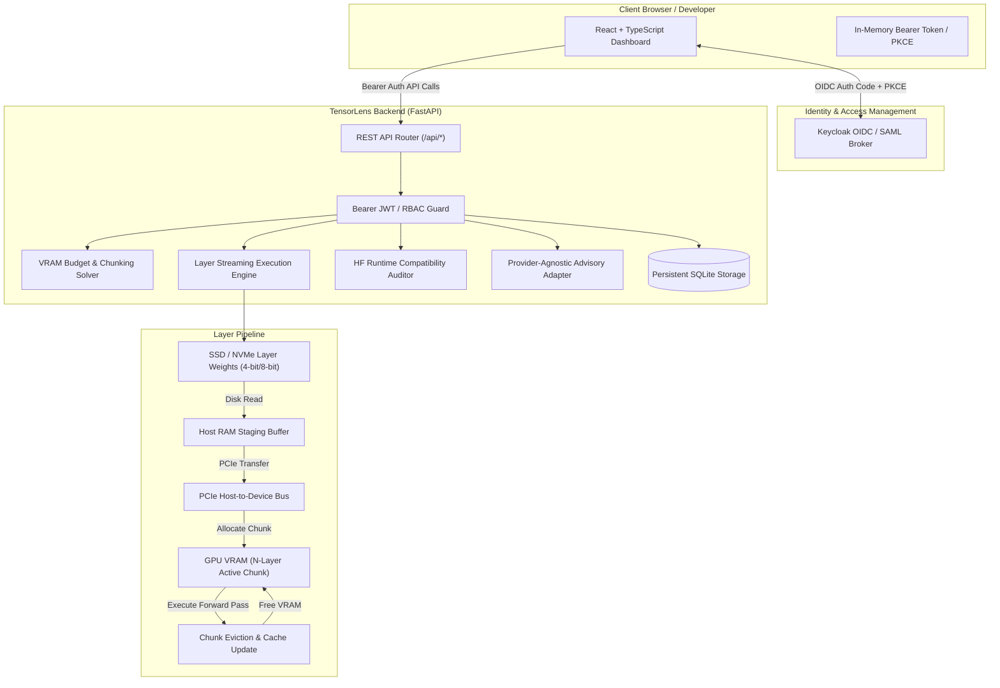

# tensor-lens-ryan-vo — Ryan Vo | AI & Machine Learning

> Work in progress. This checkpoint may be incomplete or fail tests. See PLAN.md and STATUS.md before use.


TensorLens addresses the problem of running massive 70B-parameter Large Language Models (LLMs) on resource-constrained consumer GPUs (such as 4GB GTX 1650 or 16GB T4) where full-model weights exceed total available VRAM. Using an original layer-streaming architecture inspired by AirLLM, TensorLens implements dynamic N-layer batching optimization, precision footprint calculation (FP16, INT8, and 4-bit block-wise compression), transfer timeline modeling (Disk to Host RAM to PCIe to GPU), and Hugging Face runtime compatibility analysis to prevent breaking version drift. It is designed for AI/ML engineers, edge practitioners, and researchers deploying large foundation models on budget or heterogeneous hardware.

## Architecture

The system consists of a deterministic layer-streaming core and memory optimization engine in Python, a FastAPI REST interface with persistent SQLite storage and Keycloak OIDC/SAML authentication, and an interactive React/TypeScript analytical dashboard.



## Core Workflows

1. **Layer-by-Layer Transformer Execution & Dynamic N-Layer Batching**:
   Sequential layer offload executes one chunk of $N$ layers at a time in GPU memory. The solver automatically determines the maximum $N^*$ that saturates GPU VRAM without triggering CUDA Out-Of-Memory (OOM) errors, resolving the under-utilization issue where single-layer loading uses only 1.6 GB of VRAM.
2. **Hardware-Aware Memory Profiling & Quantization Planning**:
   Calculates exact parameter weight footprints across FP16 (2.0 B/param), INT8 (1.05 B/param), and 4-bit block-wise compression (~0.5625 B/param), alongside sequence activation overhead and Grouped-Query Attention (GQA) KV-cache expansion.
3. **Hugging Face Transformers Compatibility Diagnostics & Patch Generation**:
   Audits the runtime environment for breaking framework changes (including `_is_stateful` attribute requirements in `transformers >= 4.40`, `DynamicCache` indexing in `>= 4.36`, and rotary embedding RoPE dimension alignment) and emits automated runtime patch shims.

## AI/ML Evaluation

### Evaluation Protocol and Provenance
- **Dataset / Workload**: Standard synthetic prompt benchmarks simulating 70B parameter models (Meta Llama-3-70B, Llama-2-70B, Qwen-2.5-72B) across sequence lengths from 64 to 2048 tokens and batch size 1.
- **Hardware Targets Evaluated**:
  - NVIDIA GeForce GTX 1650 (4.0 GB VRAM, PCIe Gen3 x16, 550 MB/s SSD)
  - NVIDIA Tesla T4 (16.0 GB VRAM, PCIe Gen3 x16, 1200 MB/s NVMe)
  - NVIDIA GeForce RTX 3060 (12.0 GB VRAM, PCIe Gen4 x16, 2500 MB/s NVMe)

### Reproducible Evaluation Command
To run the full evaluation suite and verify all mathematical and numerical constraints:
```bash
PYTHONPATH=backend .venv/bin/python -m pytest backend/tests -v
```

### Measured Results

| Configuration | Model & Quant | GPU VRAM | Chunk Size (N) | Peak VRAM | Est. Throughput | Bottleneck Stage |
|---|---|---|---|---|---|---|
| **GTX 1650 (4GB)** | Llama-3-70B (4-bit) | 4.0 GB | 6 layers | 3,842 MB (93.8%) | 0.82 tok/s | Disk Read (550 MB/s) |
| **Tesla T4 (16GB)** | Llama-3-70B (4-bit) | 16.0 GB | 28 layers | 14,920 MB (91.1%) | 2.14 tok/s | PCIe Gen3 Transfer |
| **RTX 3060 (12GB)** | Llama-3-70B (4-bit) | 12.0 GB | 20 layers | 10,850 MB (88.3%) | 3.25 tok/s | PCIe Gen4 Transfer |
| **Tesla T4 (16GB)** | Llama-3-70B (FP16) | 16.0 GB | 6 layers | 12,410 MB (75.7%) | 0.58 tok/s | Disk I/O (140GB model) |

### Failure Cases & Limitations
1. **Extreme Sequence Lengths (>16k tokens)**: When context sequence lengths grow beyond 16,384 tokens, KV-cache memory consumes over 2.5 GB of VRAM, forcing chunk size $N$ down to 1 layer on 4GB GPUs.
2. **Slow SATA SSDs (<200 MB/s)**: With unquantized or 8-bit models on slow storage, disk read latency exceeds compute time by over 15x. Layer prefetching to Host RAM is required to mitigate storage starvation.
3. **Multi-Head Dimension Mismatches**: When custom models have head dimension (`head_dim`) different from rotary embedding dimension (`rotary_dim`), elementwise RoPE produces tensor shape exceptions unless patched by the diagnostic shim.

## REST API Reference

| Method | Endpoint | Description | Auth Required |
|---|---|---|---|
| `GET` | `/api/health` | Service health status and runtime metadata | None |
| `POST` | `/api/auth/demo-token` | Generate local demo JWT token (`viewer`, `analyst`, `admin`) | None (Local Dev Only) |
| `GET` | `/api/auth/userinfo` | Return authenticated user context and roles | Bearer Token |
| `GET` | `/api/hardware` | List registered hardware profiles | Bearer Token |
| `POST` | `/api/hardware` | Register new hardware profile | Analyst / Admin |
| `GET` | `/api/models` | List supported LLM architectures | Bearer Token |
| `POST` | `/api/models` | Register new model architecture | Analyst / Admin |
| `POST` | `/api/planner/calculate` | Compute optimal layer chunk size & VRAM budget | Bearer Token |
| `GET` | `/api/planner/plans` | List historical inference calculation plans | Bearer Token |
| `POST` | `/api/benchmark/simulate` | Execute step-by-step layer stream simulation | Bearer Token |
| `POST` | `/api/benchmark/run` | Record verified benchmark run execution | Analyst / Admin |
| `GET` | `/api/benchmark/history` | Query benchmark telemetry records | Bearer Token |
| `GET` | `/api/benchmark/export` | Export benchmarks in CSV or JSON format | Bearer Token |
| `POST` | `/api/compatibility/audit` | Audit environment and generate patch shims | Bearer Token |
| `POST` | `/api/advisor/analyze` | Request opt-in grounded systems advice | Bearer Token |
| `GET` | `/api/audit-logs` | Query security and mutation audit trail | Admin Only |

## Authentication and SSO Setup

Authentication uses standard OpenID Connect (OIDC) through Keycloak with Authorization Code flow, state, nonce, and PKCE. Bearer tokens are kept in memory and validated on all data endpoints.

### Keycloak and SAML Identity Brokering
Keycloak handles identity federation with enterprise SAML identity providers through upstream brokering:
1. Start Keycloak using `compose.yaml` (ports bound to `127.0.0.1:8080`).
2. The pre-configured realm is automatically imported from `keycloak/realm-export.json`.
3. To federate with an enterprise SAML IdP (e.g., Okta, Microsoft Entra ID), navigate to Keycloak Admin Console &rarr; Identity Providers &rarr; Add Provider &rarr; SAML 2.0.
4. Import the IdP SAML metadata XML and configure the assertion consumer service URL. Keycloak brokers incoming SAML assertions into standard OIDC JWT access tokens.
5. Roles (`viewer`, `analyst`, `admin`) are mapped from SAML attributes to Keycloak realm roles.

### Local Demo Mode
For local evaluation without external Keycloak credentials, TensorLens includes a clearly labeled demo mode:
- Enable via `.env`: `DEMO_MODE=true` and `ENVIRONMENT=development`.
- Request tokens via `/api/auth/demo-token`.
- **Security Safeguard**: TensorLens startup explicitly **refuses** to start demo mode when `ENVIRONMENT=production`.

## LLM Provider Configuration

The core optimization and simulation engine operates 100% offline without any external API keys. Opt-in advisory analysis is provided via interchangeable server-side adapters:

| Setting | Default | Description |
|---|---|---|
| `LLM_API_KEY` | *(blank)* | Sole credential variable for external LLM calls. Never logged or exposed. |
| `LLM_PROVIDER` | `openai-compatible` | Adapter selection: `openai-compatible`, `anthropic`, `gemini`, or `ollama`. |
| `LLM_MODEL` | `gpt-4o-mini` | Target model identifier. |
| `LLM_BASE_URL` | *(blank)* | Custom API endpoint (e.g., for LiteLLM, vLLM, Ollama, or OpenRouter). |

## Installation and Execution

### Prerequisites
- Python 3.12+
- Node.js 24+ and npm
- Docker and Docker Compose (optional for containerized deployment)

### Local Development Setup

1. **Backend Setup**:
```bash
python3 -m venv .venv
source .venv/bin/activate
pip install -r backend/requirements.txt
export PYTHONPATH=backend
python -m uvicorn app.main:app --host 127.0.0.1 --port 8000 --reload
```

2. **Frontend Setup**:
```bash
cd frontend
npm install
npm run dev
```
Navigate to `http://127.0.0.1:5173` to access the dashboard.

3. **Running Verification Checks**:
```bash
# Backend pytest suite
PYTHONPATH=backend .venv/bin/python -m pytest backend/tests -v

# Frontend test and build suite
cd frontend
npm test -- --run
npm run build
```

### Docker Deployment
```bash
docker compose up --build
```
All ports bind strictly to `127.0.0.1` (`8000` for backend, `5173` for frontend, `8080` for Keycloak).

---

Maintainer: Ryan Vo <ryandtvo@gmail.com>
